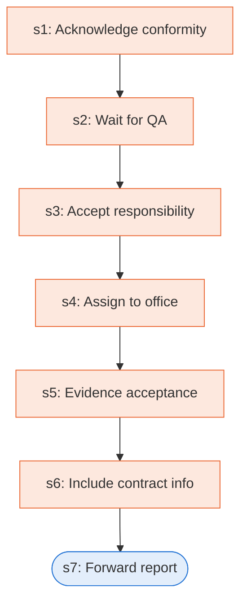

# Runbook: Acceptance of supplies or services and the receiving report

Source: FAR 46.501, 46.502 and 32.905(c), https://www.acquisition.gov/far/46.501

Generated from the `LLM-compiled` workflow spec. Rounded boxes are agent steps, square boxes are human steps.

| Step | Action | Owner | Executor | Hands to | Deadline | Source lines |
|---|---|---|---|---|---|---|
| s1 | Acknowledge conformity | contracting officer | human |  |  | L1 |
| s2 | Wait for QA | contracting officer | human |  |  | L2 |
| s3 | Accept responsibility | contracting officer | human |  |  | L3 |
| s4 | Assign to office | contracting officer | human | cognizant contract administration office |  | L4 |
| s5 | Evidence acceptance | contracting officer | human |  |  | L5 |
| s6 | Include contract info | contracting officer | human |  |  | L6 |
| s7 | Forward report | agency receiving official | agent | designated payment office |  | L7 |

## Handoffs

- **s4** contracting officer to **cognizant contract administration office**: Assign to office
- **s7** agency receiving official to **designated payment office**: Forward report
