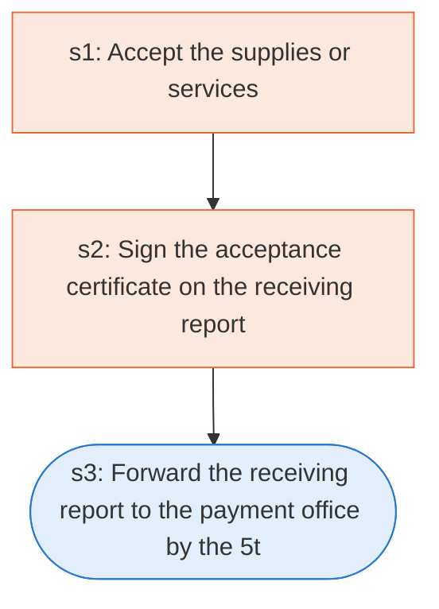

# Runbook: Acceptance of supplies or services and the receiving report

Source: FAR 46.501, 46.502 and 32.905(c), https://www.acquisition.gov/far/46.501

Generated from the `gold` workflow spec. Rounded boxes are agent steps, square boxes are human steps.

| Step | Action | Owner | Executor | Hands to | Deadline | Source lines |
|---|---|---|---|---|---|---|
| s1 | Accept the supplies or services | contracting officer | human |  |  | L3 |
| s2 | Sign the acceptance certificate on the receiving report | designated Government official | human |  |  | L5, L6 |
| s3 | Forward the receiving report to the payment office by the 5th working day | agency receiving official | agent | payment office |  | L7 |

## Handoffs

- **s3** agency receiving official to **payment office**: Forward the receiving report to the payment office by the 5th working day
