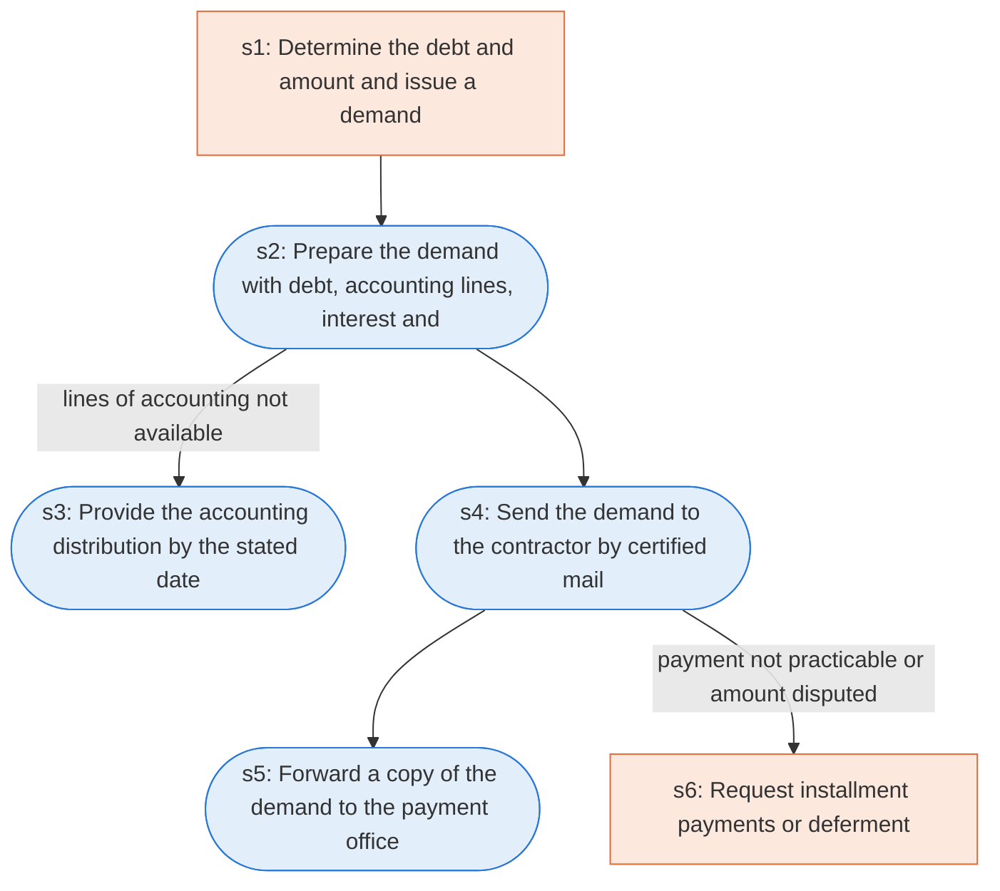

# Runbook: Contract debts: demand for payment

Source: FAR 32.604, https://www.acquisition.gov/far/32.604

Generated from the `gold` workflow spec. Rounded boxes are agent steps, square boxes are human steps.

| Step | Action | Owner | Executor | Hands to | Deadline | Source lines |
|---|---|---|---|---|---|---|
| s1 | Determine the debt and amount and issue a demand | contracting officer | human |  |  | L1, L2, L3 |
| s2 | Prepare the demand with debt, accounting lines, interest and dispute contact | contracting officer | agent |  |  | L4, L6 |
| s3 | Provide the accounting distribution by the stated date | contracting officer | agent |  |  | L5 |
| s4 | Send the demand to the contractor by certified mail | contracting officer | agent | contractor |  | L7 |
| s5 | Forward a copy of the demand to the payment office | contracting officer | agent | payment office |  | L8 |
| s6 | Request installment payments or deferment | contractor | human | contracting officer |  | L9 |

## Handoffs

- **s4** contracting officer to **contractor**: Send the demand to the contractor by certified mail
- **s5** contracting officer to **payment office**: Forward a copy of the demand to the payment office
- **s6** contractor to **contracting officer**: Request installment payments or deferment
