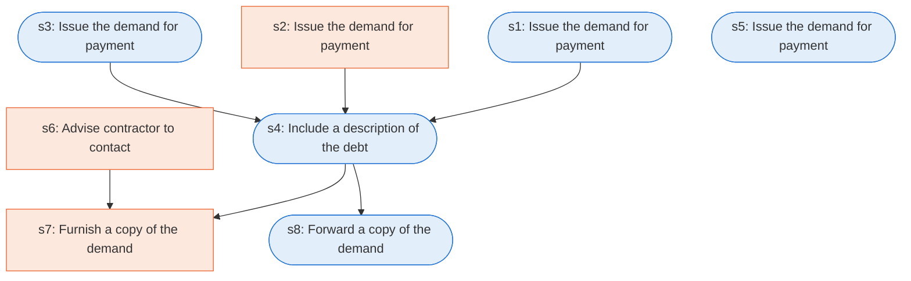

# Runbook: Contract debts: demand for payment

Source: FAR 32.604, https://www.acquisition.gov/far/32.604

Generated from the `LLM-compiled` workflow spec. Rounded boxes are agent steps, square boxes are human steps.

| Step | Action | Owner | Executor | Hands to | Deadline | Source lines |
|---|---|---|---|---|---|---|
| s1 | Issue the demand for payment | contracting officer | agent | null |  | L1 |
| s2 | Issue the demand for payment | contracting officer | human | null |  | L2 |
| s3 | Issue the demand for payment | contracting officer | agent | null |  | L3 |
| s4 | Include a description of the debt | contracting officer | agent | null |  | L4 |
| s5 | Issue the demand for payment | contracting officer | agent | null |  | L5 |
| s6 | Advise contractor to contact | contracting officer | human | contractor |  | L6 |
| s7 | Furnish a copy of the demand | contracting officer | human | contractor |  | L7 |
| s8 | Forward a copy of the demand | contracting officer | agent | payment office |  | L8 |

## Handoffs

- **s1** contracting officer to **null**: Issue the demand for payment
- **s2** contracting officer to **null**: Issue the demand for payment
- **s3** contracting officer to **null**: Issue the demand for payment
- **s4** contracting officer to **null**: Include a description of the debt
- **s5** contracting officer to **null**: Issue the demand for payment
- **s6** contracting officer to **contractor**: Advise contractor to contact
- **s7** contracting officer to **contractor**: Furnish a copy of the demand
- **s8** contracting officer to **payment office**: Forward a copy of the demand
