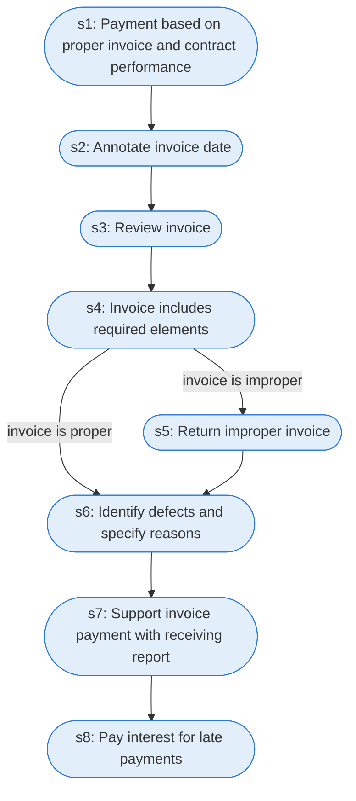

# Runbook: Invoice receipt, review and payment

Source: FAR 32.905 and 5 CFR 1315.4 (Prompt Payment), https://www.acquisition.gov/far/32.905 and https://www.ecfr.gov/current/title-5/chapter-III/subchapter-B/part-1315

Generated from the `LLM-compiled` workflow spec. Rounded boxes are agent steps, square boxes are human steps.

| Step | Action | Owner | Executor | Hands to | Deadline | Source lines |
|---|---|---|---|---|---|---|
| s1 | Payment based on proper invoice and contract performance | designated payment office | agent |  |  | L1 |
| s2 | Annotate invoice date | designated payment office | agent |  |  | L2 |
| s3 | Review invoice | designated agency office | agent |  |  | L3 |
| s4 | Invoice includes required elements | designated agency office | agent |  |  | L4 |
| s5 | Return improper invoice | designated agency office | agent | vendor | no later than 7 days after receipt | L5 |
| s6 | Identify defects and specify reasons | designated agency office | agent |  |  | L6 |
| s7 | Support invoice payment with receiving report | designated agency office | agent |  |  | L7 |
| s8 | Pay interest for late payments | designated agency office | agent |  |  | L8 |

## Handoffs

- **s5** designated agency office to **vendor**: Return improper invoice
