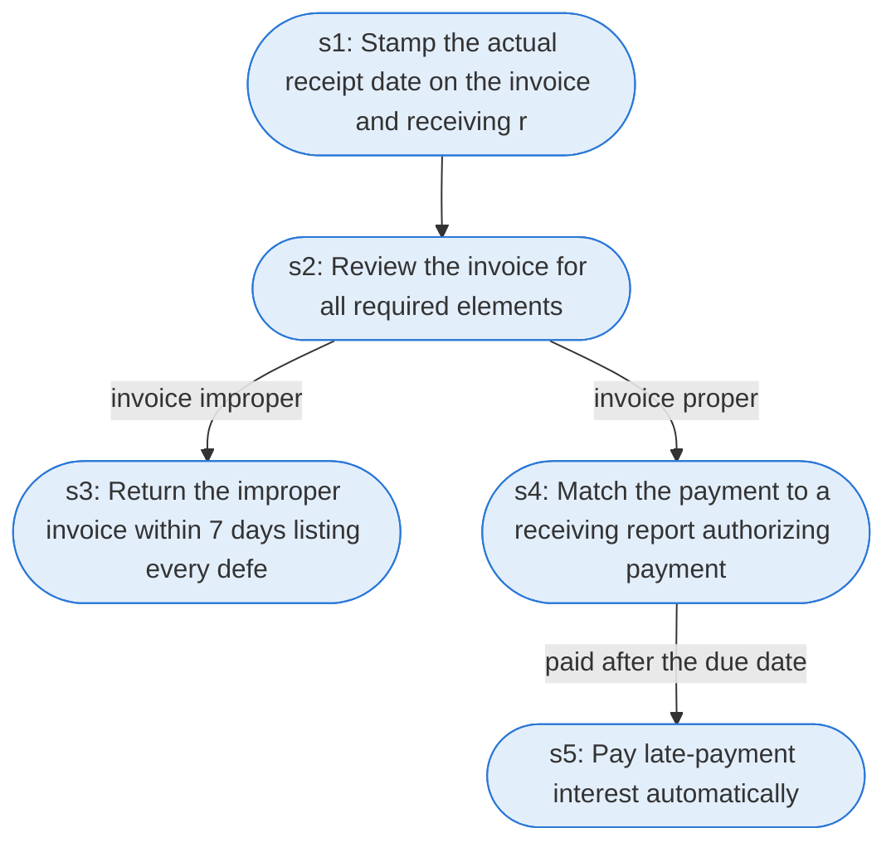

# Runbook: Invoice receipt, review and payment

Source: FAR 32.905 and 5 CFR 1315.4 (Prompt Payment), https://www.acquisition.gov/far/32.905 and https://www.ecfr.gov/current/title-5/chapter-III/subchapter-B/part-1315

Generated from the `gold` workflow spec. Rounded boxes are agent steps, square boxes are human steps.

| Step | Action | Owner | Executor | Hands to | Deadline | Source lines |
|---|---|---|---|---|---|---|
| s1 | Stamp the actual receipt date on the invoice and receiving report | payment office | agent |  |  | L2 |
| s2 | Review the invoice for all required elements | agency office | agent |  |  | L3, L4 |
| s3 | Return the improper invoice within 7 days listing every defect | agency office | agent | vendor | no later than 7 days after receipt | L5, L6 |
| s4 | Match the payment to a receiving report authorizing payment | payment office | agent |  |  | L7 |
| s5 | Pay late-payment interest automatically | payment office | agent |  |  | L8 |

## Handoffs

- **s3** agency office to **vendor**: Return the improper invoice within 7 days listing every defect
