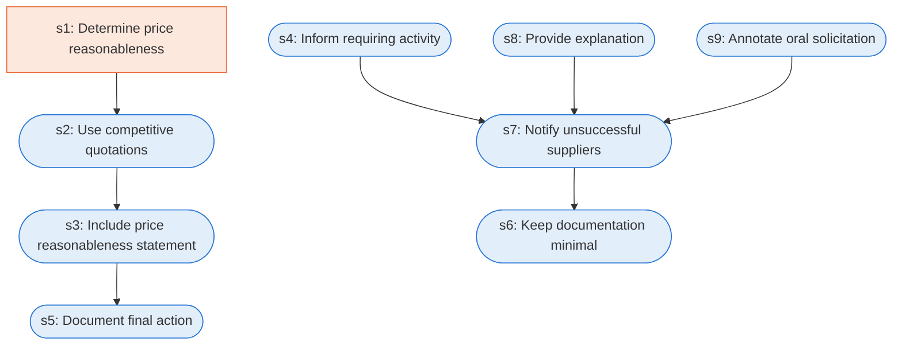

# Runbook: Simplified acquisition: award and documentation

Source: FAR 13.106-3, https://www.acquisition.gov/far/13.106-3

Generated from the `LLM-compiled` workflow spec. Rounded boxes are agent steps, square boxes are human steps.

| Step | Action | Owner | Executor | Hands to | Deadline | Source lines |
|---|---|---|---|---|---|---|
| s1 | Determine price reasonableness | contracting officer | human |  |  | L1 |
| s2 | Use competitive quotations | contracting officer | agent |  |  | L2 |
| s3 | Include price reasonableness statement | contracting officer | agent | contract file |  | L3 |
| s4 | Inform requiring activity | contracting officer | agent | requiring activity |  | L4 |
| s5 | Document final action | contracting officer | agent | file |  | L5 |
| s6 | Keep documentation minimal | contracting officer | agent |  |  | L6 |
| s7 | Notify unsuccessful suppliers | contracting officer | agent | unsuccessful suppliers |  | L7 |
| s8 | Provide explanation | contracting officer | agent | payment office |  | L8 |
| s9 | Annotate oral solicitation | contracting officer | agent | payment office |  | L9 |

## Handoffs

- **s3** contracting officer to **contract file**: Include price reasonableness statement
- **s4** contracting officer to **requiring activity**: Inform requiring activity
- **s5** contracting officer to **file**: Document final action
- **s7** contracting officer to **unsuccessful suppliers**: Notify unsuccessful suppliers
- **s8** contracting officer to **payment office**: Provide explanation
- **s9** contracting officer to **payment office**: Annotate oral solicitation
