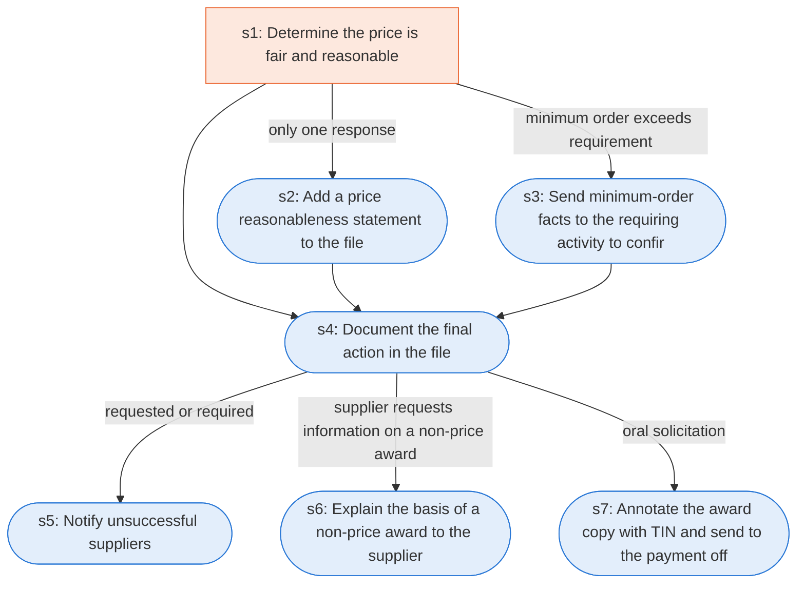

# Runbook: Simplified acquisition: award and documentation

Source: FAR 13.106-3, https://www.acquisition.gov/far/13.106-3

Generated from the `gold` workflow spec. Rounded boxes are agent steps, square boxes are human steps.

| Step | Action | Owner | Executor | Hands to | Deadline | Source lines |
|---|---|---|---|---|---|---|
| s1 | Determine the price is fair and reasonable | contracting officer | human |  |  | L1, L2 |
| s2 | Add a price reasonableness statement to the file | contracting officer | agent |  |  | L3 |
| s3 | Send minimum-order facts to the requiring activity to confirm or alter the requirement | contracting officer | agent | requiring activity |  | L4 |
| s4 | Document the final action in the file | contracting officer | agent |  |  | L5 |
| s5 | Notify unsuccessful suppliers | contracting officer | agent | unsuccessful suppliers |  | L7 |
| s6 | Explain the basis of a non-price award to the supplier | contracting officer | agent | supplier |  | L8 |
| s7 | Annotate the award copy with TIN and send to the payment office | contracting officer | agent | payment office |  | L9 |

## Handoffs

- **s3** contracting officer to **requiring activity**: Send minimum-order facts to the requiring activity to confirm or alter the requirement
- **s5** contracting officer to **unsuccessful suppliers**: Notify unsuccessful suppliers
- **s6** contracting officer to **supplier**: Explain the basis of a non-price award to the supplier
- **s7** contracting officer to **payment office**: Annotate the award copy with TIN and send to the payment office
