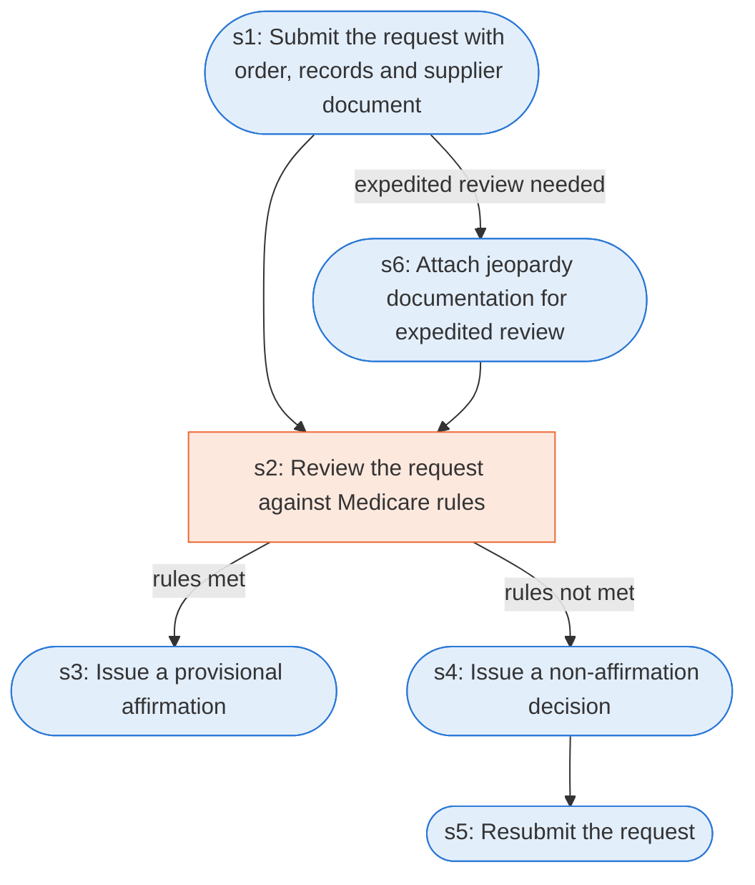

# Runbook: Prior authorization for DMEPOS items

Source: 42 CFR 414.234(d) and (e) (CMS), https://www.ecfr.gov/current/title-42/chapter-IV/subchapter-B/part-414/subpart-D/section-414.234

Generated from the `gold` workflow spec. Rounded boxes are agent steps, square boxes are human steps.

| Step | Action | Owner | Executor | Hands to | Deadline | Source lines |
|---|---|---|---|---|---|---|
| s1 | Submit the request with order, records and supplier documentation before furnishing | supplier | agent | CMS or contractor |  | L1, L2 |
| s2 | Review the request against Medicare rules | CMS contractor | human |  |  | L3 |
| s3 | Issue a provisional affirmation | CMS contractor | agent | requester |  | L4 |
| s4 | Issue a non-affirmation decision | CMS contractor | agent | requester |  | L5 |
| s5 | Resubmit the request | supplier | agent | CMS or contractor |  | L6 |
| s6 | Attach jeopardy documentation for expedited review | supplier | agent |  |  | L7 |

## Handoffs

- **s1** supplier to **CMS or contractor**: Submit the request with order, records and supplier documentation before furnishing
- **s3** CMS contractor to **requester**: Issue a provisional affirmation
- **s4** CMS contractor to **requester**: Issue a non-affirmation decision
- **s5** supplier to **CMS or contractor**: Resubmit the request
