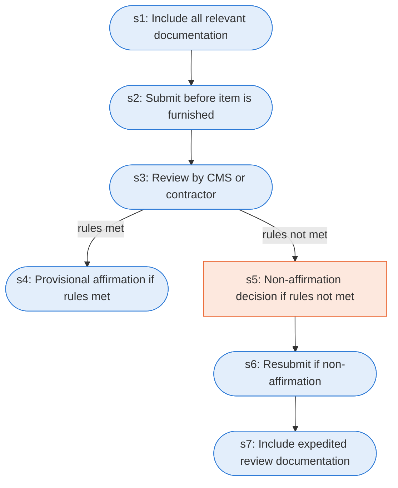

# Runbook: Prior authorization for DMEPOS items

Source: 42 CFR 414.234(d) and (e) (CMS), https://www.ecfr.gov/current/title-42/chapter-IV/subchapter-B/part-414/subpart-D/section-414.234

Generated from the `LLM-compiled` workflow spec. Rounded boxes are agent steps, square boxes are human steps.

| Step | Action | Owner | Executor | Hands to | Deadline | Source lines |
|---|---|---|---|---|---|---|
| s1 | Include all relevant documentation | requester | agent |  |  | L1 |
| s2 | Submit before item is furnished | requester | agent |  |  | L2 |
| s3 | Review by CMS or contractor | CMS or contractor | agent |  |  | L3 |
| s4 | Provisional affirmation if rules met | CMS or contractor | agent |  |  | L4 |
| s5 | Non-affirmation decision if rules not met | CMS or contractor | human |  |  | L5 |
| s6 | Resubmit if non-affirmation | requester | agent |  |  | L6 |
| s7 | Include expedited review documentation | requester | agent |  |  | L7 |

## Handoffs

- none
