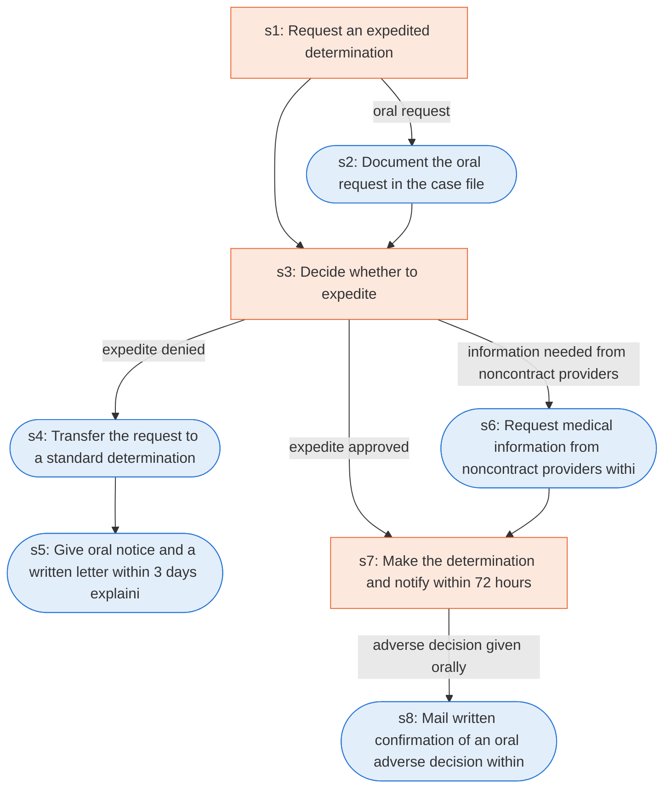

# Runbook: Medicare Advantage expedited organization determination

Source: 42 CFR 422.570 and 422.572, https://www.ecfr.gov/current/title-42/chapter-IV/subchapter-B/part-422/subpart-M

Generated from the `gold` workflow spec. Rounded boxes are agent steps, square boxes are human steps.

| Step | Action | Owner | Executor | Hands to | Deadline | Source lines |
|---|---|---|---|---|---|---|
| s1 | Request an expedited determination | enrollee or physician | human | MA organization |  | L1 |
| s2 | Document the oral request in the case file | MA organization | agent |  |  | L2 |
| s3 | Decide whether to expedite | MA organization | human |  |  | L3 |
| s4 | Transfer the request to a standard determination | MA organization | agent |  |  | L5 |
| s5 | Give oral notice and a written letter within 3 days explaining the denial of expedite | MA organization | agent | enrollee | within 3 calendar days | L6 |
| s6 | Request medical information from noncontract providers within 24 hours | MA organization | agent | noncontract providers | within 24 hours of the initial request | L7 |
| s7 | Make the determination and notify within 72 hours | MA organization | human | enrollee | no later than 72 hours after receiving the request | L8 |
| s8 | Mail written confirmation of an oral adverse decision within 3 days | MA organization | agent | enrollee | within 3 calendar days of the oral notification | L9 |

## Handoffs

- **s1** enrollee or physician to **MA organization**: Request an expedited determination
- **s5** MA organization to **enrollee**: Give oral notice and a written letter within 3 days explaining the denial of expedite
- **s6** MA organization to **noncontract providers**: Request medical information from noncontract providers within 24 hours
- **s7** MA organization to **enrollee**: Make the determination and notify within 72 hours
- **s8** MA organization to **enrollee**: Mail written confirmation of an oral adverse decision within 3 days
