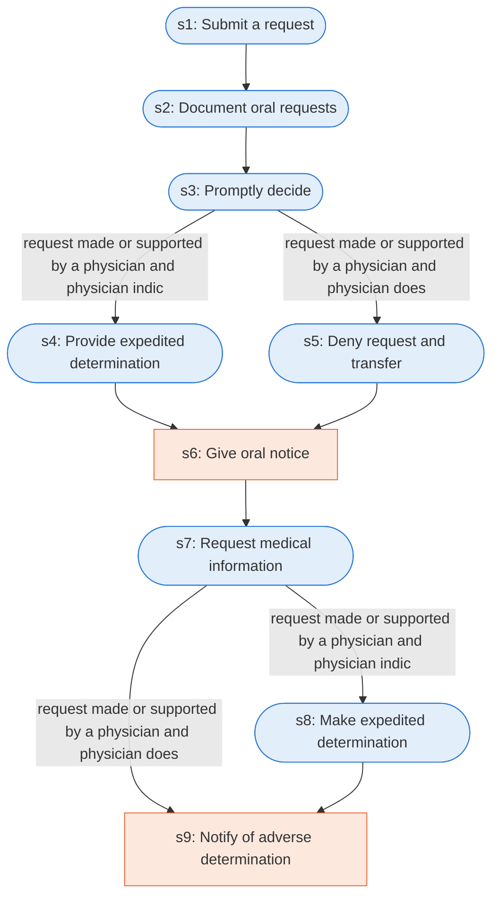

# Runbook: Medicare Advantage expedited organization determination

Source: 42 CFR 422.570 and 422.572, https://www.ecfr.gov/current/title-42/chapter-IV/subchapter-B/part-422/subpart-M

Generated from the `LLM-compiled` workflow spec. Rounded boxes are agent steps, square boxes are human steps.

| Step | Action | Owner | Executor | Hands to | Deadline | Source lines |
|---|---|---|---|---|---|---|
| s1 | Submit a request | enrollee or physician | agent |  |  | L1 |
| s2 | Document oral requests | MA organization | agent |  |  | L2 |
| s3 | Promptly decide | MA organization | agent |  |  | L3 |
| s4 | Provide expedited determination | MA organization | agent | enrollee |  | L4 |
| s5 | Deny request and transfer | MA organization | agent | enrollee |  | L5 |
| s6 | Give oral notice | MA organization | human | enrollee | within 3 calendar days | L6 |
| s7 | Request medical information | MA organization | agent |  | within 24 hours of the initial request | L7 |
| s8 | Make expedited determination | MA organization | agent | enrollee | no later than 72 hours after receiving the request | L8 |
| s9 | Notify of adverse determination | MA organization | human | enrollee | within 3 calendar days of the oral notification | L9 |

## Handoffs

- **s4** MA organization to **enrollee**: Provide expedited determination
- **s5** MA organization to **enrollee**: Deny request and transfer
- **s6** MA organization to **enrollee**: Give oral notice
- **s8** MA organization to **enrollee**: Make expedited determination
- **s9** MA organization to **enrollee**: Notify of adverse determination
