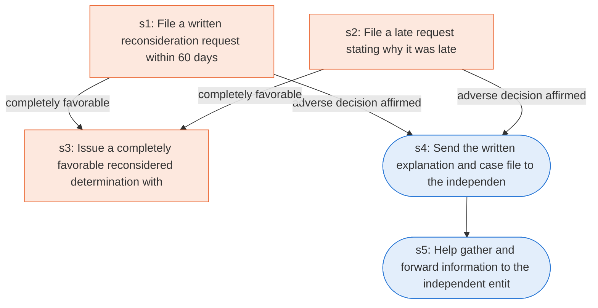

# Runbook: Medicare Advantage standard reconsideration of an adverse determination

Source: 42 CFR 422.582 and 422.590 (CMS), https://www.ecfr.gov/current/title-42/chapter-IV/subchapter-B/part-422/subpart-M

Generated from the `gold` workflow spec. Rounded boxes are agent steps, square boxes are human steps.

| Step | Action | Owner | Executor | Hands to | Deadline | Source lines |
|---|---|---|---|---|---|---|
| s1 | File a written reconsideration request within 60 days | party | human | MA organization | within 60 calendar days after receipt of the written organization determination notice | L1, L2 |
| s2 | File a late request stating why it was late | party | human | MA organization |  | L3 |
| s3 | Issue a completely favorable reconsidered determination within 30 days | MA organization | human | enrollee | no later than 30 calendar days from the date it receives the request | L4 |
| s4 | Send the written explanation and case file to the independent entity within 30 days | MA organization | agent | independent entity | no later than 30 calendar days from the date it receives the request | L5 |
| s5 | Help gather and forward information to the independent entity | MA organization | agent | independent entity |  | L6 |

## Handoffs

- **s1** party to **MA organization**: File a written reconsideration request within 60 days
- **s2** party to **MA organization**: File a late request stating why it was late
- **s3** MA organization to **enrollee**: Issue a completely favorable reconsidered determination within 30 days
- **s4** MA organization to **independent entity**: Send the written explanation and case file to the independent entity within 30 days
- **s5** MA organization to **independent entity**: Help gather and forward information to the independent entity
