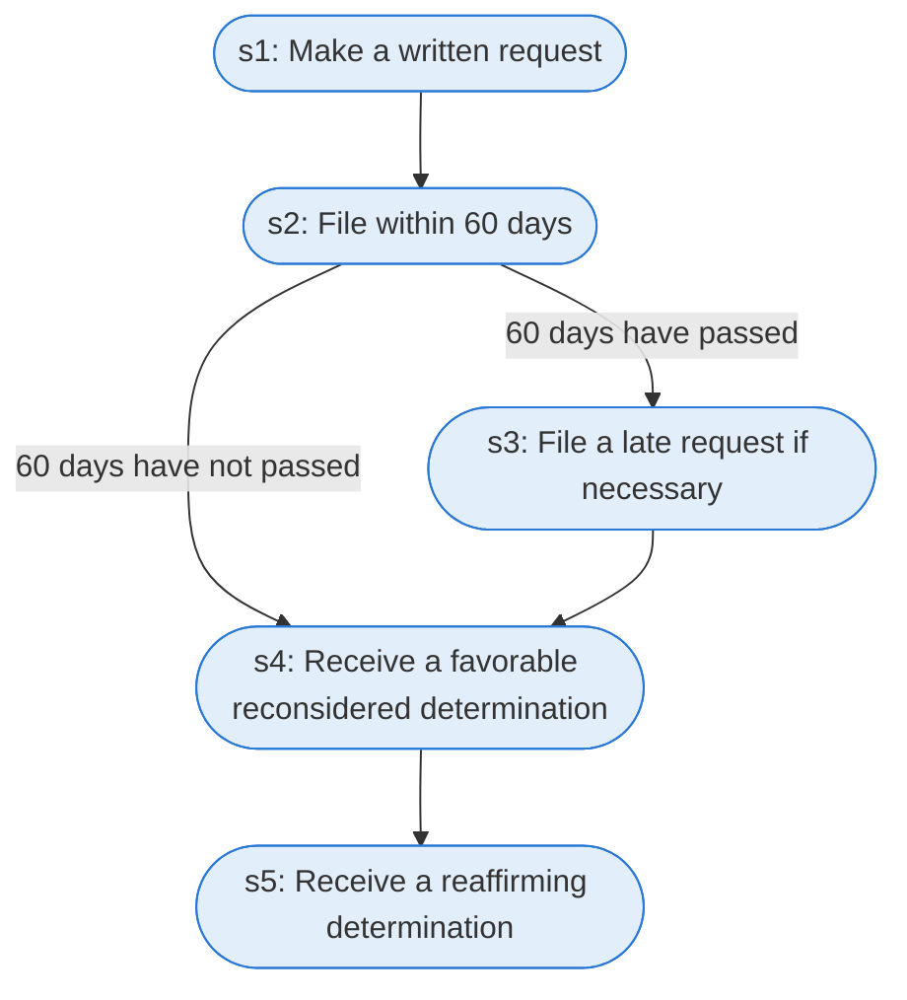

# Runbook: Medicare Advantage standard reconsideration of an adverse determination

Source: 42 CFR 422.582 and 422.590 (CMS), https://www.ecfr.gov/current/title-42/chapter-IV/subchapter-B/part-422/subpart-M

Generated from the `LLM-compiled` workflow spec. Rounded boxes are agent steps, square boxes are human steps.

| Step | Action | Owner | Executor | Hands to | Deadline | Source lines |
|---|---|---|---|---|---|---|
| s1 | Make a written request | party to the organization determination | agent | MA organization |  | L1 |
| s2 | File within 60 days | party to the organization determination | agent |  | within 60 calendar days after receipt of the written organization determination notice | L2 |
| s3 | File a late request if necessary | party to the organization determination | agent | MA organization |  | L3 |
| s4 | Receive a favorable reconsidered determination | MA organization | agent |  | no later than 30 calendar days from the date it receives the request | L4 |
| s5 | Receive a reaffirming determination | MA organization | agent | CMS contracted entity | no later than 30 calendar days from the date it receives the request | L5 |

## Handoffs

- **s1** party to the organization determination to **MA organization**: Make a written request
- **s3** party to the organization determination to **MA organization**: File a late request if necessary
- **s5** MA organization to **CMS contracted entity**: Receive a reaffirming determination
