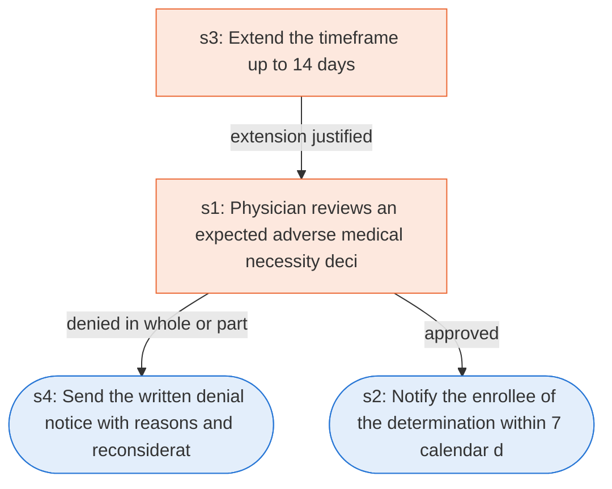

# Runbook: Medicare Advantage standard organization determination (prior authorization)

Source: 42 CFR 422.566(d) and 422.568, https://www.ecfr.gov/current/title-42/chapter-IV/subchapter-B/part-422/subpart-M

Generated from the `gold` workflow spec. Rounded boxes are agent steps, square boxes are human steps.

| Step | Action | Owner | Executor | Hands to | Deadline | Source lines |
|---|---|---|---|---|---|---|
| s1 | Physician reviews an expected adverse medical necessity decision | physician reviewer | human |  |  | L3 |
| s2 | Notify the enrollee of the determination within 7 calendar days | MA organization | agent | enrollee | no later than 7 calendar days after receiving the request for the standard organization determination | L1 |
| s3 | Extend the timeframe up to 14 days | MA organization | human |  |  | L2 |
| s4 | Send the written denial notice with reasons and reconsideration rights | MA organization | agent | enrollee and provider |  | L4, L5 |

## Handoffs

- **s2** MA organization to **enrollee**: Notify the enrollee of the determination within 7 calendar days
- **s4** MA organization to **enrollee and provider**: Send the written denial notice with reasons and reconsideration rights
