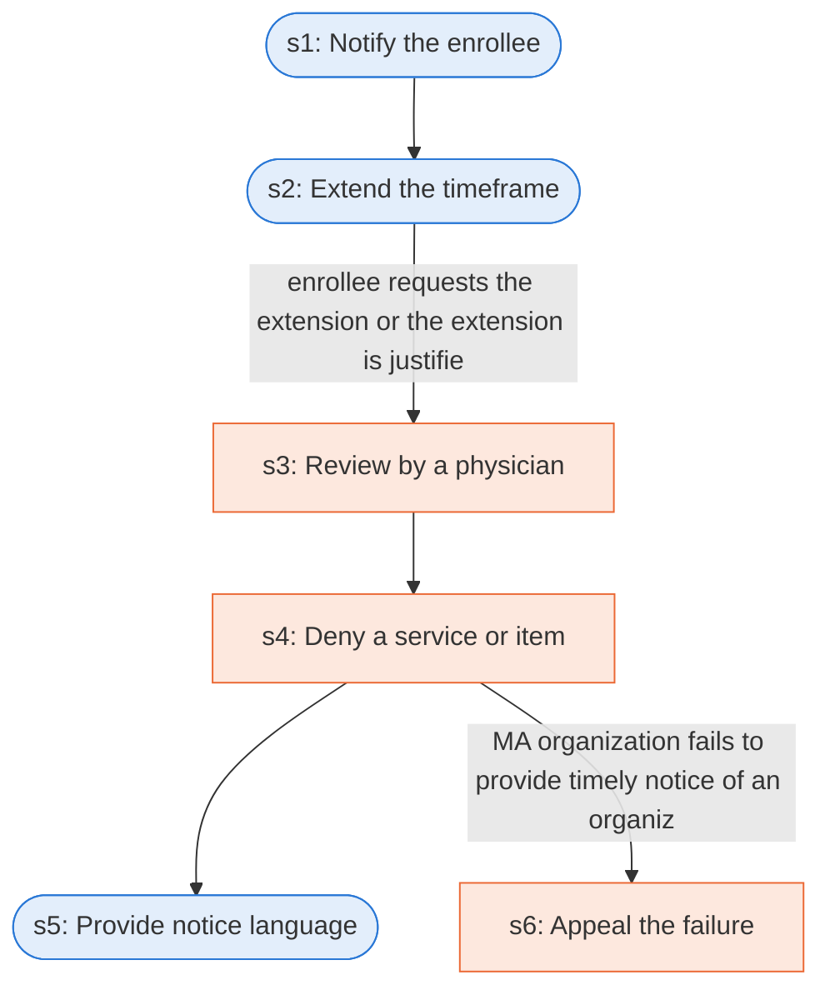

# Runbook: Medicare Advantage standard organization determination (prior authorization)

Source: 42 CFR 422.566(d) and 422.568, https://www.ecfr.gov/current/title-42/chapter-IV/subchapter-B/part-422/subpart-M

Generated from the `LLM-compiled` workflow spec. Rounded boxes are agent steps, square boxes are human steps.

| Step | Action | Owner | Executor | Hands to | Deadline | Source lines |
|---|---|---|---|---|---|---|
| s1 | Notify the enrollee | MA organization | agent | enrollee | no later than 7 calendar days after receiving the request for the standard organization determination | L1 |
| s2 | Extend the timeframe | MA organization | agent |  |  | L2 |
| s3 | Review by a physician | MA organization | human |  |  | L3 |
| s4 | Deny a service or item | MA organization | human | enrollee and physician |  | L4 |
| s5 | Provide notice language | MA organization | agent | enrollee |  | L5 |
| s6 | Appeal the failure | MA organization | human |  |  | L6 |

## Handoffs

- **s1** MA organization to **enrollee**: Notify the enrollee
- **s4** MA organization to **enrollee and physician**: Deny a service or item
- **s5** MA organization to **enrollee**: Provide notice language
