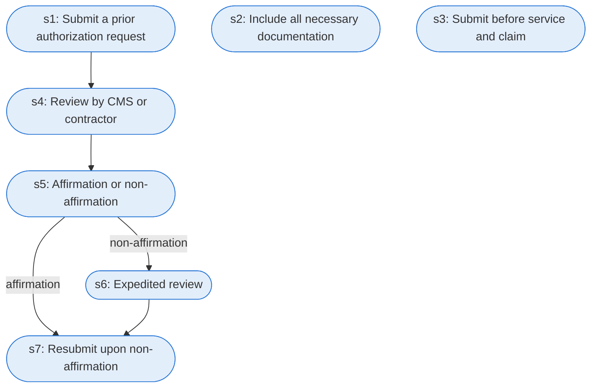

# Runbook: Prior authorization for hospital outpatient department services

Source: 42 CFR 419.82 (CMS), https://www.ecfr.gov/current/title-42/chapter-IV/subchapter-B/part-419/subpart-I/section-419.82

Generated from the `LLM-compiled` workflow spec. Rounded boxes are agent steps, square boxes are human steps.

| Step | Action | Owner | Executor | Hands to | Deadline | Source lines |
|---|---|---|---|---|---|---|
| s1 | Submit a prior authorization request | provider | agent | CMS or its contractor |  | L1 |
| s2 | Include all necessary documentation | provider | agent |  |  | L2 |
| s3 | Submit before service and claim | provider | agent |  |  | L3 |
| s4 | Review by CMS or contractor | CMS or contractor | agent |  |  | L4 |
| s5 | Affirmation or non-affirmation | CMS or contractor | agent | provider | within 7 calendar days of receipt of the request | L5 |
| s6 | Expedited review | CMS or contractor | agent |  | within 2 business days | L6 |
| s7 | Resubmit upon non-affirmation | provider | agent |  |  | L7 |

## Handoffs

- **s1** provider to **CMS or its contractor**: Submit a prior authorization request
- **s5** CMS or contractor to **provider**: Affirmation or non-affirmation
