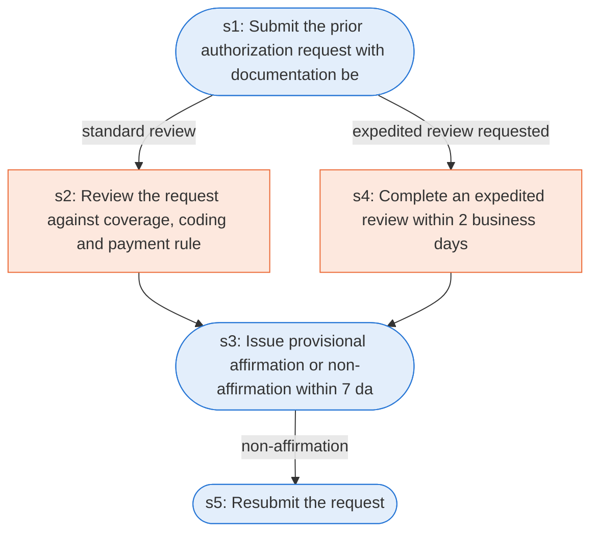

# Runbook: Prior authorization for hospital outpatient department services

Source: 42 CFR 419.82 (CMS), https://www.ecfr.gov/current/title-42/chapter-IV/subchapter-B/part-419/subpart-I/section-419.82

Generated from the `gold` workflow spec. Rounded boxes are agent steps, square boxes are human steps.

| Step | Action | Owner | Executor | Hands to | Deadline | Source lines |
|---|---|---|---|---|---|---|
| s1 | Submit the prior authorization request with documentation before service | provider | agent | CMS or contractor |  | L1, L2, L3 |
| s2 | Review the request against coverage, coding and payment rules | CMS contractor | human |  |  | L4 |
| s3 | Issue provisional affirmation or non-affirmation within 7 days | CMS contractor | agent | provider | within 7 calendar days of receipt of the request | L5 |
| s4 | Complete an expedited review within 2 business days | CMS contractor | human |  | within 2 business days | L6 |
| s5 | Resubmit the request | provider | agent | CMS or contractor |  | L7 |

## Handoffs

- **s1** provider to **CMS or contractor**: Submit the prior authorization request with documentation before service
- **s3** CMS contractor to **provider**: Issue provisional affirmation or non-affirmation within 7 days
- **s5** provider to **CMS or contractor**: Resubmit the request
