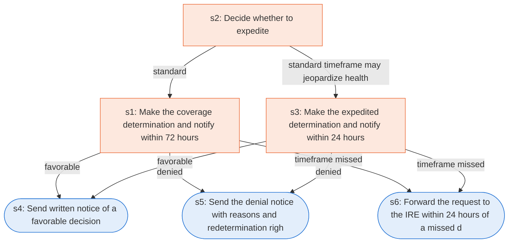

# Runbook: Medicare Part D coverage determination

Source: 42 CFR 423.568, 423.570 and 423.572 (CMS), https://www.ecfr.gov/current/title-42/chapter-IV/subchapter-B/part-423/subpart-M

Generated from the `gold` workflow spec. Rounded boxes are agent steps, square boxes are human steps.

| Step | Action | Owner | Executor | Hands to | Deadline | Source lines |
|---|---|---|---|---|---|---|
| s1 | Make the coverage determination and notify within 72 hours | Part D plan sponsor | human | enrollee and prescriber | no later than 72 hours after receipt of the request | L1 |
| s2 | Decide whether to expedite | Part D plan sponsor | human |  |  | L2 |
| s3 | Make the expedited determination and notify within 24 hours | Part D plan sponsor | human | enrollee and prescriber | no later than 24 hours after receiving the request | L3 |
| s4 | Send written notice of a favorable decision | Part D plan sponsor | agent | enrollee |  | L4 |
| s5 | Send the denial notice with reasons and redetermination rights | Part D plan sponsor | agent | enrollee |  | L5 |
| s6 | Forward the request to the IRE within 24 hours of a missed deadline | Part D plan sponsor | agent | IRE | within 24 hours of the expiration of the adjudication timeframe | L6 |

## Handoffs

- **s1** Part D plan sponsor to **enrollee and prescriber**: Make the coverage determination and notify within 72 hours
- **s3** Part D plan sponsor to **enrollee and prescriber**: Make the expedited determination and notify within 24 hours
- **s4** Part D plan sponsor to **enrollee**: Send written notice of a favorable decision
- **s5** Part D plan sponsor to **enrollee**: Send the denial notice with reasons and redetermination rights
- **s6** Part D plan sponsor to **IRE**: Forward the request to the IRE within 24 hours of a missed deadline
