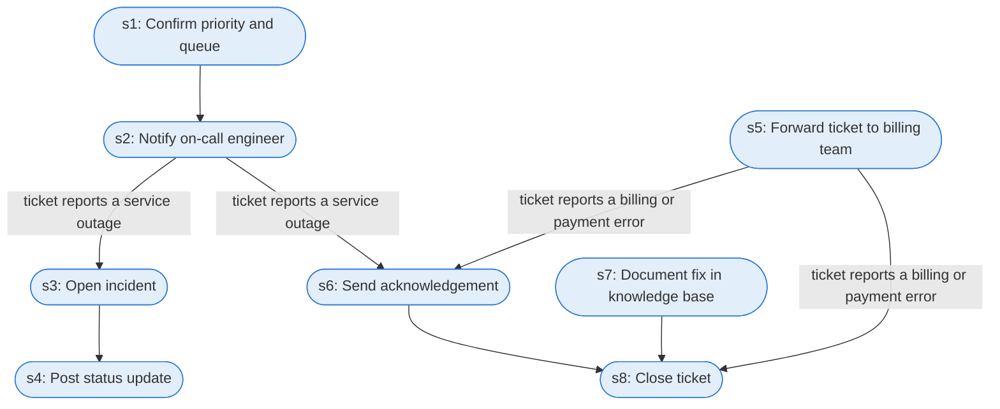

# Runbook: High-priority ticket escalation (authored)

Source: AUTHORED for this project as a companion to sup_ticket_triage_auto_reply; queue and priority mix from the 16,335-ticket dataset used in agent-replay-console; not a public or Oracle document

Generated from the `LLM-compiled` workflow spec. Rounded boxes are agent steps, square boxes are human steps.

| Step | Action | Owner | Executor | Hands to | Deadline | Source lines |
|---|---|---|---|---|---|---|
| s1 | Confirm priority and queue | support agent | agent |  |  | L1 |
| s2 | Notify on-call engineer | support agent | agent | on-call engineer | within 1 hour of arrival | L2 |
| s3 | Open incident | on-call engineer | agent |  |  | L3 |
| s4 | Post status update | on-call engineer | agent |  |  | L4 |
| s5 | Forward ticket to billing team | support agent | agent | billing team |  | L5 |
| s6 | Send acknowledgement | support agent | agent | customer |  | L6 |
| s7 | Document fix in knowledge base | owning team | agent |  |  | L7 |
| s8 | Close ticket | owning team | agent |  |  | L7 |

## Handoffs

- **s2** support agent to **on-call engineer**: Notify on-call engineer
- **s5** support agent to **billing team**: Forward ticket to billing team
- **s6** support agent to **customer**: Send acknowledgement
