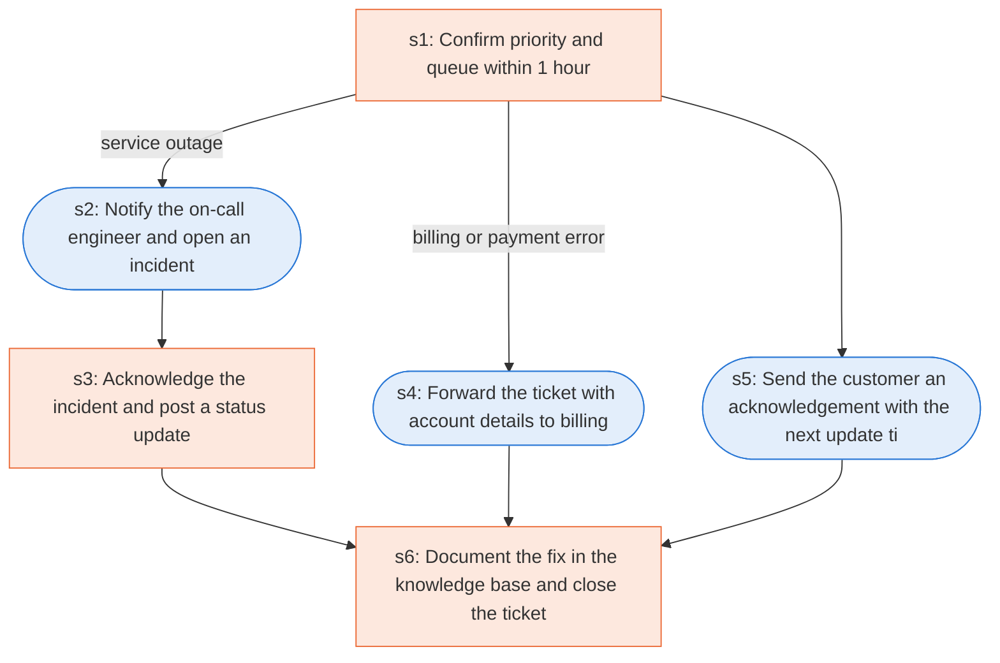

# Runbook: High-priority ticket escalation (authored)

Source: AUTHORED for this project as a companion to sup_ticket_triage_auto_reply; queue and priority mix from the 16,335-ticket dataset used in agent-replay-console; not a public or Oracle document

Generated from the `gold` workflow spec. Rounded boxes are agent steps, square boxes are human steps.

| Step | Action | Owner | Executor | Hands to | Deadline | Source lines |
|---|---|---|---|---|---|---|
| s1 | Confirm priority and queue within 1 hour | support agent | human |  | within 1 hour of arrival | L2 |
| s2 | Notify the on-call engineer and open an incident | support agent | agent | on-call engineer |  | L3 |
| s3 | Acknowledge the incident and post a status update | on-call engineer | human | customer |  | L4 |
| s4 | Forward the ticket with account details to billing | support agent | agent | billing team |  | L5 |
| s5 | Send the customer an acknowledgement with the next update time | support agent | agent | customer |  | L6 |
| s6 | Document the fix in the knowledge base and close the ticket | owning team | human |  |  | L7 |

## Handoffs

- **s2** support agent to **on-call engineer**: Notify the on-call engineer and open an incident
- **s3** on-call engineer to **customer**: Acknowledge the incident and post a status update
- **s4** support agent to **billing team**: Forward the ticket with account details to billing
- **s5** support agent to **customer**: Send the customer an acknowledgement with the next update time
