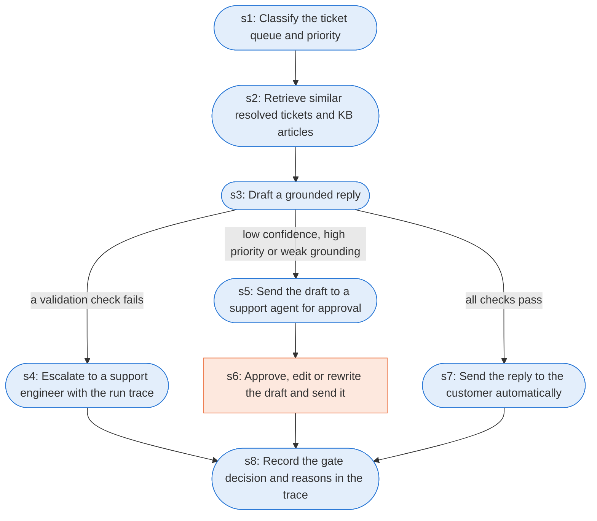

# Runbook: Support ticket triage and auto-reply gate (authored)

Source: AUTHORED for this project from the gate policy of github.com/Jitesh-Mishra/agent-replay-console (arc/agent.py, gate_decision); not a public or Oracle document

Generated from the `gold` workflow spec. Rounded boxes are agent steps, square boxes are human steps.

| Step | Action | Owner | Executor | Hands to | Deadline | Source lines |
|---|---|---|---|---|---|---|
| s1 | Classify the ticket queue and priority | support agent system | agent |  |  | L1 |
| s2 | Retrieve similar resolved tickets and KB articles | support agent system | agent |  |  | L2 |
| s3 | Draft a grounded reply | support agent system | agent |  |  | L3 |
| s4 | Escalate to a support engineer with the run trace | support agent system | agent | support engineer |  | L4 |
| s5 | Send the draft to a support agent for approval | support agent system | agent | support agent |  | L5 |
| s6 | Approve, edit or rewrite the draft and send it | support agent | human | customer |  | L6 |
| s7 | Send the reply to the customer automatically | support agent system | agent | customer |  | L7 |
| s8 | Record the gate decision and reasons in the trace | support agent system | agent |  |  | L8 |

## Handoffs

- **s4** support agent system to **support engineer**: Escalate to a support engineer with the run trace
- **s5** support agent system to **support agent**: Send the draft to a support agent for approval
- **s6** support agent to **customer**: Approve, edit or rewrite the draft and send it
- **s7** support agent system to **customer**: Send the reply to the customer automatically
