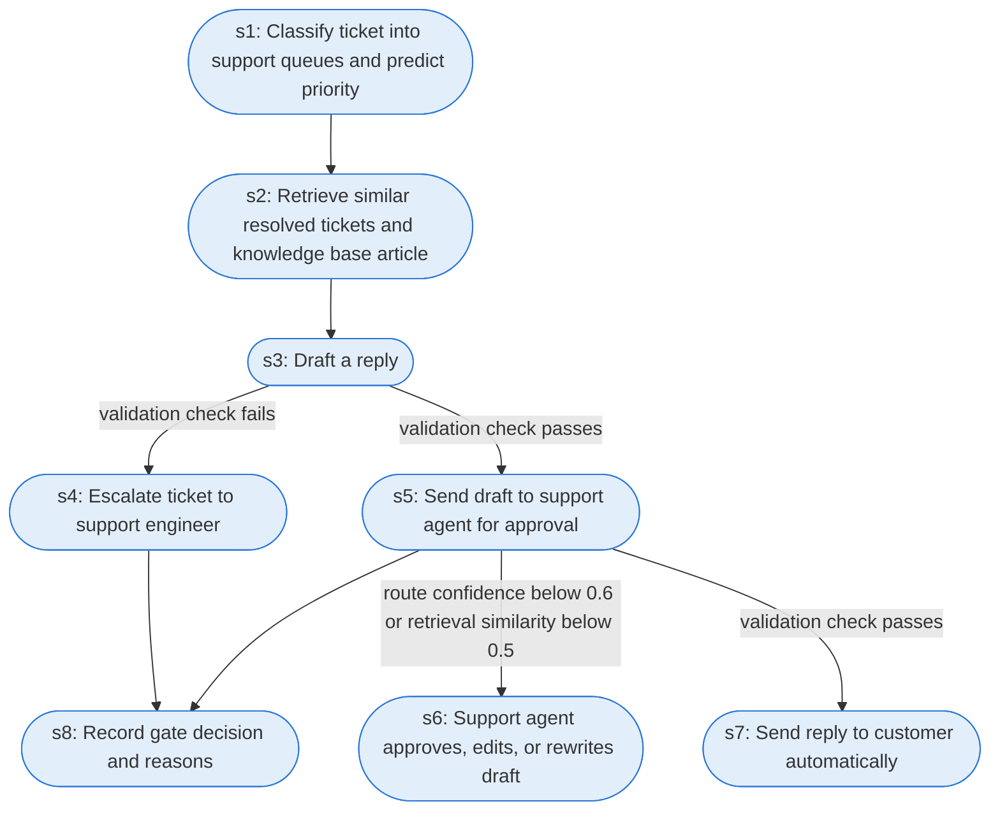

# Runbook: Support ticket triage and auto-reply gate (authored)

Source: AUTHORED for this project from the gate policy of github.com/Jitesh-Mishra/agent-replay-console (arc/agent.py, gate_decision); not a public or Oracle document

Generated from the `LLM-compiled` workflow spec. Rounded boxes are agent steps, square boxes are human steps.

| Step | Action | Owner | Executor | Hands to | Deadline | Source lines |
|---|---|---|---|---|---|---|
| s1 | Classify ticket into support queues and predict priority | system | agent |  |  | L1 |
| s2 | Retrieve similar resolved tickets and knowledge base articles | system | agent |  |  | L2 |
| s3 | Draft a reply | system | agent |  |  | L3 |
| s4 | Escalate ticket to support engineer | system | agent | support engineer |  | L4 |
| s5 | Send draft to support agent for approval | system | agent | support agent |  | L5 |
| s6 | Support agent approves, edits, or rewrites draft | support agent | agent |  |  | L6 |
| s7 | Send reply to customer automatically | system | agent | customer |  | L7 |
| s8 | Record gate decision and reasons | system | agent |  |  | L8 |

## Handoffs

- **s4** system to **support engineer**: Escalate ticket to support engineer
- **s5** system to **support agent**: Send draft to support agent for approval
- **s7** system to **customer**: Send reply to customer automatically
